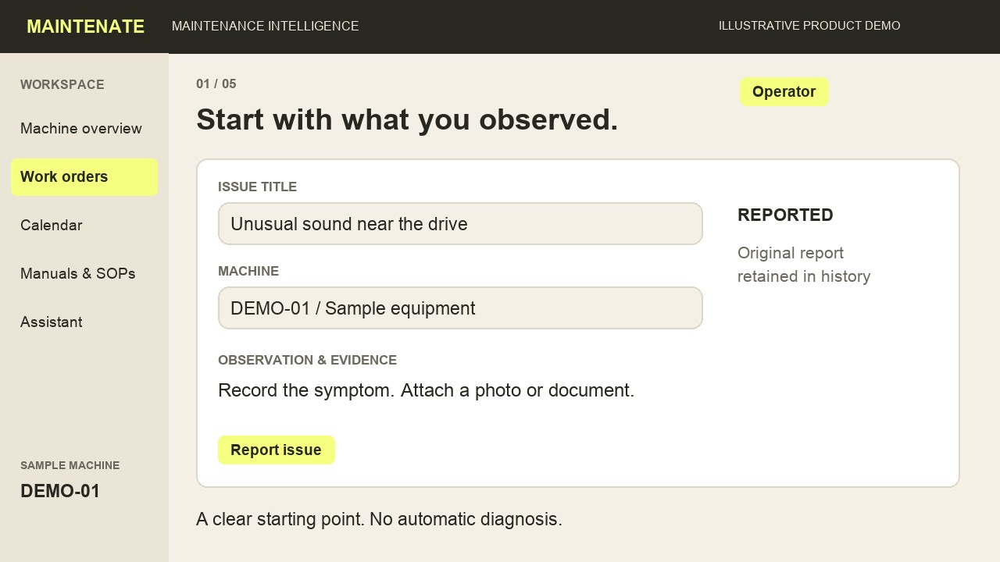
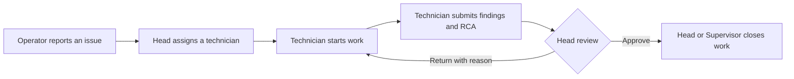
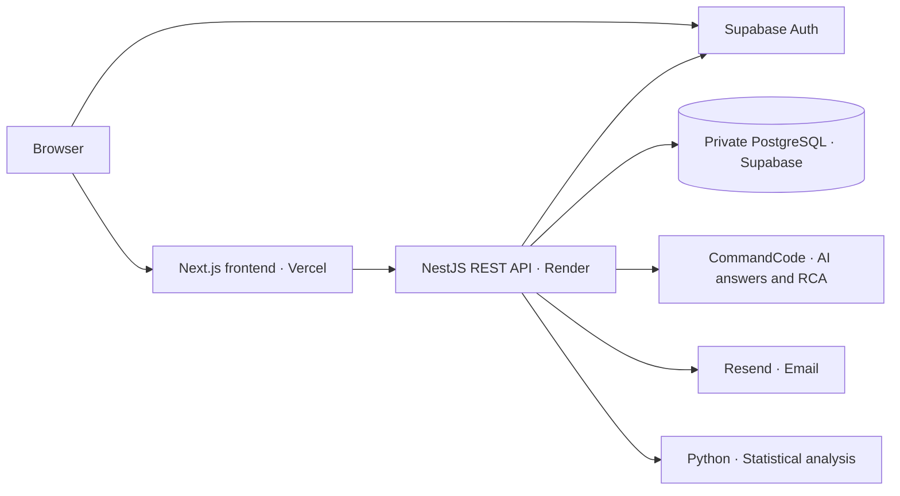

<div align="center">
  
  <h1>Maintenate</h1>
  <p><strong>Machine maintenance. Clearer decisions.</strong></p>
  <p>A shared workspace for maintenance teams to manage equipment, coordinate work,<br />track production and ask questions about approved machine references.</p>
  <p>
    <a href="https://maintenate.vercel.app"><strong>Open Maintenate</strong></a>
    &nbsp; · &nbsp;
    <a href="#the-workflow">Explore the workflow</a>
    &nbsp; · &nbsp;
    <a href="#local-development">Run locally</a>
    &nbsp; · &nbsp;
    <a href="docs/VERIFICATION.md">Verification notes</a>
  </p>
  <p>
    <a href="https://github.com/sarthakmarkad/AI-Maintenance-System/actions/workflows/checks.yml"></a>
    <a href="https://github.com/sarthakmarkad/AI-Maintenance-System/actions/workflows/deployment-package.yml"></a>
    
  </p>
</div>

---

## One place for the maintenance workflow

Maintenate connects an observed issue to an assigned technician, recorded findings, human review and a retained maintenance history. It also brings planned maintenance, production imports, machine references and advisory AI into the same role-controlled workspace.

The public landing page is open to visitors. **The platform requires sign-in and an authorized organization membership**; knowing the URL does not grant access. Administrators invite staff and assign roles and machine access.

<a href="https://maintenate.vercel.app">
  
</a>

*Illustrative product walkthrough—not an operational record or a screenshot of every current screen. [Watch it on the landing page](https://maintenate.vercel.app) · [Walkthrough provenance](docs/LANDING-VIDEO.md)*

## What you can do

| Area | Capabilities |
|---|---|
| **Equipment & people** | Register machines, edit details, upload private machine photos, archive/restore assets, invite staff and manage roles and machine access. |
| **Maintenance work** | Report breakdowns, assign technicians, capture findings and human RCA, return or approve submissions, close approved work and retain the complete history. |
| **Planned maintenance** | Create recurring plans with fixed IST due dates, review due/overdue tasks, explicitly release planned work and receive in-app reminders. |
| **Production & process data** | Preview and validate Excel imports before saving, inspect production/scrap totals, explore synthetic process trends and retain source references. Standard templates are available for registered machines; supported legacy layouts can be connected through an explicit workbook-to-machine confirmation and reused after a successful import. |
| **Statistical review** | Inspect sudden changes, sustained shifts and gradual drifts with supporting readings. Heads can retain a review and explicitly open an investigation. |
| **Evidence & reporting** | Preview photos, access private attachments, inspect maintenance workload and export maintenance registers or work-order history as PDF/Excel. |
| **Notifications** | Receive role-specific in-app handoffs and opt into eligible work-order emails through a configured sender. |
| **Knowledge & AI** | Version and approve PDF manuals/SOPs, ask follow-up questions with page citations, and generate advisory RCA drafts for human editing and review. |

Detailed behavior and boundaries are documented in the [feature guides](#documentation).

## The workflow

### From an issue to a reviewed repair



Original reports, earlier submissions, actor roles and event times remain in history. Version checks and duplicate-safe requests protect against competing updates and repeated submissions.

Planned work and investigations use their own completion evidence. They do not require a fabricated breakdown cause or restoration time. Statistical flags never create work orders automatically.

### Clear responsibilities

| Role | Main responsibility |
|---|---|
| **Administrator** | Manage staff, machine registry and access. Upload reference drafts; no engineering approval authority. |
| **Operator** | Report observations and add permitted evidence on assigned machines. |
| **Technician** | Start and complete assigned work, record findings and submit for review. |
| **Maintenance Head** | Assign work, review submissions, manage maintenance plans and approve/withdraw references. |
| **Supervisor** | Review operational visibility and close approved work within authorized scope. |
| **Plant Management** | Inspect scoped dashboards, maintenance activity, reports and approved references. |

All six roles can use the scoped assistant. Permissions come from trusted application records; signing in with Google or changing browser data cannot assign a role. See [team access](docs/TEAM-ACCESS.md) and [staff management](docs/STAFF-MANAGEMENT.md).

## AI with traceable references

The assistant handles general conversation and retrieves document passages when a question needs an approved manual or SOP.

- **Answers:** DeepSeek V4.1 Flash through the backend-only CommandCode integration.
- **Retrieval:** PostgreSQL keyword search over page-aware text from current approved PDFs. The hosted keyword path requires neither Ollama nor a paid embedding API.
- **Evidence:** Document answers include checked quotations, reference revisions and PDF page citations. A separate support check runs before delivery.
- **Access:** Organization/machine scope and current approvals are checked again before returning an answer. Replaced or withdrawn sources are excluded; affected saved replies are redacted on subsequent reads.
- **Privacy:** CommandCode requests require the zero-data-retention routing header. Questions, bounded conversation context and selected passages are sent to the provider; credentials stay on the backend.
- **Human control:** RCA drafts remain advisory. A technician reviews/edits them, and the normal human approval workflow still applies.

Keyword search can miss paraphrases. AI can make mistakes, and library approval does not override a training/sample warning inside a file. Existing vector indexes remain available through the optional legacy hybrid mode. See [assistant setup and limits](docs/DOCUMENT-AI.md).

## Architecture



| Layer | Technology |
|---|---|
| Frontend | Next.js App Router, React, TypeScript, Tailwind/shadcn-style components, Recharts |
| Backend | NestJS REST, TypeScript, generated OpenAPI contracts |
| Persistence | Prisma, PostgreSQL/pgvector, restricted runtime login and private `maintenance` schema |
| Authentication | Supabase Auth, email/password and Google OAuth |
| Processing | Python statistics worker, ExcelJS, Poppler PDF text extraction |
| Hosting | Vercel frontend, Render Free API, Supabase database/Auth |

Files, source evidence and saved chats are private application records. The browser uses authenticated API endpoints for operational data; it has no direct access to the private database schema. Migration credentials are separate from runtime credentials.

## Local development

**Requirements:** Node.js 22.12–24, npm 11 and Python 3.9+. PDF indexing additionally needs Poppler (`pdfinfo` and `pdftotext`). Native local database setup needs PostgreSQL 16 with pgvector and its binaries on `PATH`; a Docker alternative is documented in [deployment guidance](docs/DEPLOYMENT.md).

### Existing configured workspace

```sh
npm ci
npm run dev
```

Existing hosted data is already initialized. Starting development does **not** require seeding, restoring a backup or repeating the database transfer.

### Fresh local checkout

```sh
git clone https://github.com/sarthakmarkad/AI-Maintenance-System.git
cd AI-Maintenance-System
npm ci

# Native bootstrap creates a private root .env; do not pre-create it for this path.
npm run db:local
cp apps/web/.env.example apps/web/.env.local
```

Configure Supabase Auth in both private environment files using the supplied [backend](.env.example) and [frontend](apps/web/.env.example) examples. Preserve the database credentials created by bootstrap. Use only the public publishable key in frontend settings.

For this **fresh local database only**:

```sh
npm run db:migrate
npm run db:seed
npm run db:grants
npm run dev
```

The native database uses port `55432`, separate from an existing server on `5432`. If a root `.env` already exists, bootstrap will not overwrite it; follow the manual connection setup in the [database runbook](docs/SUPABASE-MIGRATION.md). Core protected routes fail closed until Auth and trusted membership are configured.

| Local service | Address |
|---|---|
| Web app | http://localhost:3000 |
| REST API | http://localhost:4000/api |
| Swagger UI | http://localhost:4000/api/docs |
| OpenAPI JSON | http://localhost:4000/api/openapi.json |
| Readiness | http://localhost:4000/api/health/ready |

<details>
<summary><strong>First Administrator and optional services</strong></summary>

For a new seeded installation, create/verify the first Administrator in Supabase Auth, confirm the actual user UUID and provision the trusted membership through local administration:

```sh
npm run db:provision -- <actual-auth-user-uuid> ADMINISTRATOR "Display name"
```

This command targets the seeded pilot organization; it is not public self-registration. Further staff join through **Team → Invite staff**. Operators and Technicians require explicit machine grants. Configure [Google OAuth](docs/GOOGLE-SIGN-IN-SETUP.md), [staff SMTP](docs/STAFF-MANAGEMENT.md) and [work-order email](docs/EXTERNAL-NOTIFICATIONS.md) using their guides.

For keyword-based AI, install Poppler, configure the existing CommandCode account and set these backend-only values:

```dotenv
DOCUMENT_AI_PROVIDER=commandcode
COMMANDCODE_MODEL=deepseek/deepseek-v4.1-flash
DOCUMENT_RETRIEVAL_MODE=keyword
DOCUMENT_AI_ENABLED=true
```

Store `COMMANDCODE_API_KEY` privately in the backend environment. Answer calls consume the provider account's allowance. An OpenAI API key is not needed for this configuration. Restart after changing environment settings.

</details>

## Testing & verification

```sh
npm run typecheck       # API, web and browser-test TypeScript
npm test                # Unit and provider-contract tests
npm run test:db         # Isolated PostgreSQL integration tests
npm run test:web        # Desktop/mobile browser fixtures
npm run test:system     # Isolated real API/database browser journeys
npm run build           # Production API and frontend build
npm run db:audit        # Read-only audit of the configured database
```

Install the browser once with `npm exec playwright -- install chromium`. Database tests require matching `TEST_DATABASE_URL` and `TEST_RUNTIME_DATABASE_URL` connections to a separate database ending in `_test`. Never use operational databases for test incidents.

`npm run test:ai:keyword` is an explicit real-provider acceptance test confined to `_test`; it consumes the configured answer-provider allowance and is not part of ordinary CI. `npm run api:generate` refreshes the OpenAPI contracts.

See [system testing](docs/SYSTEM-TESTING.md) and [verification evidence](docs/VERIFICATION.md) for executed checks, fixture boundaries and remaining acceptance work. CI badges report the repository checks, not a guarantee of production reliability.

## Deployment & operating boundaries

The app is deployed at **[maintenate.vercel.app](https://maintenate.vercel.app)** with its API on Render and operational persistence in Supabase. Follow the [deployment runbook](docs/DEPLOYMENT.md) for private environment settings, Auth redirects, migrations and rollback.

- **Render Free can sleep.** First requests may be slow; embedded schedules, indexing and email jobs pause while the API sleeps.
- **AI responses are checked before display.** Standalone greetings avoid model calls; clear document continuations skip routing. Document generation and support verification can still take several seconds.
- **Process analysis is synthetic.** Demonstration readings and their flags do not establish real machine faults or causes of company production losses.
- **Imports use reviewed layouts.** WH-C is the original validated pilot; its exact model is unknown. Registered machines support the tested standard templates. Other columns, units or process parameters need explicit reviewed mappings.
- **Removal preserves history.** Machines can be archived/restored and eligible work orders cancelled; historical evidence is retained.
- **Operational rollout needs company acceptance.** Validate real staff handoffs, suitable machine documents, backup restoration and hosting capacity before relying on the system for daily work.

## Repository map

```text
apps/
  web/                  Next.js interface and authenticated workspaces
  api/                  NestJS API, workflows, imports and AI adapters
packages/api-client/    Generated API types and shared chat formatting
services/statistics/    Isolated Python statistical analysis
prisma/                 Schema and reviewed migrations
scripts/                Administration, database tools and checks
infra/                  Runtime grants and deployment packaging
docs/                   Feature guides, decisions and verification
```

Credentials, company workbooks, local database files and test artifacts are excluded from Git. `Maintenance_Handoff/` is ignored, read-only local reference material.

## Documentation

| Topic | Guides |
|---|---|
| Assets & staff | [Registry](docs/MACHINE-REGISTRY.md) · [Machine editing/photos](docs/MACHINE-EDITING.md) · [Staff](docs/STAFF-MANAGEMENT.md) · [Permissions](docs/TEAM-ACCESS.md) |
| Maintenance | [Work orders](docs/WORK-ORDERS.md) · [Calendar](docs/CALENDAR.md) · [Removal](docs/RECORD-REMOVAL.md) |
| Data & analysis | [Production imports](docs/PRODUCTION-IMPORT.md) · [Process readings](docs/PROCESS-READINGS.md) · [Excel templates](docs/STANDARD-EXCEL-TEMPLATES.md) · [Statistical patterns](docs/STATISTICAL-PATTERNS.md) |
| Knowledge & AI | [Document library](docs/DOCUMENT-LIBRARY.md) · [Assistant](docs/DOCUMENT-AI.md) · [AI RCA drafting](docs/AI-RCA-DRAFTING.md) |
| Evidence & visibility | [Attachments](docs/ATTACHMENTS.md) · [Reports](docs/REPORTS.md) · [Performance](docs/MAINTENANCE-PERFORMANCE.md) |
| Notifications | [In-app](docs/WORK-ORDER-NOTIFICATIONS.md) · [Email](docs/EXTERNAL-NOTIFICATIONS.md) |
| Engineering & operations | [Deployment](docs/DEPLOYMENT.md) · [Database](docs/SUPABASE-MIGRATION.md) · [Decisions](docs/DECISIONS.md) · [Verification](docs/VERIFICATION.md) |
